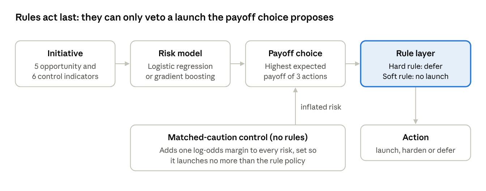
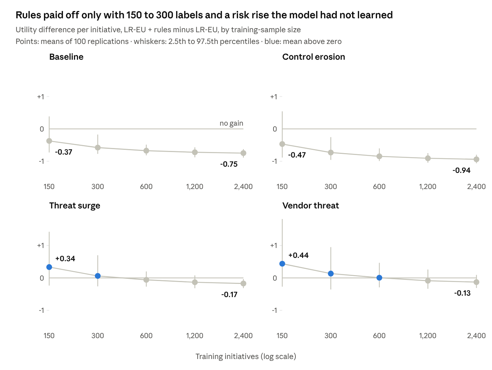

# When do expert screening rules pay off? Label scarcity, deployment shift and rule error in cybersecurity-aware digital transformation screening

________________________^a,∗^

^a^ ________________________ (affiliation, city, country)

∗ Corresponding author. E-mail: ________________________

## Abstract

Knowledge-based screening of digital transformation initiatives often pairs a learned breach-risk score with expert cybersecurity rules. Earlier work found that such rules reduce launched breaches but not decision utility when training and deployment data come from the same world. This study asks when rules do pay, and whether any gain reflects the knowledge they encode or only extra caution. A reproducible simulation crosses five training-sample sizes (150 to 2,400 initiatives) with four deployment scenarios: no shift, erosion of control maturity, an emerging vendor threat and a uniform threat surge. Each of the 20 cells has 100 replications of 5,000 deployment initiatives. Rules act on a payoff-optimal expected-utility policy, and a matched-caution control launches as many initiatives using one uniform risk margin. Seven hypotheses were written before the full run; two survived. Rules lowered the launched-breach share in all 20 cells, by 4.7 to 8.5 percentage points. They raised mean utility appreciably only with 150 or 300 training initiatives under the threat surge and the vendor threat (by 0.06 to 0.44 units per initiative), and they cost utility at every training size in the other two scenarios. The matched-caution policy had higher mean utility than the rules in 19 of 20 cells, because at equal launch counts the rules launched more breach-prone initiatives. One rule, targeting the vendor-control gap, raised utility in all 100 replications at every training size when the vendor threat arrived and lowered it in all 100 when it did not. Expert rules are therefore best priced one by one, as insurance against specific threats the data have not shown, with general caution delivered through calibrated risk margins. The results hold only under the stated simulation assumptions.

**Keywords:** Knowledge-based systems; Decision support; Cybersecurity; Digital transformation; Dataset shift; Expert rules

## 1. Introduction

Organisations screen digital transformation initiatives on indicators of opportunity, such as innovation, entrepreneurship and data use (Vial, 2019; Verhoef et al., 2021). Those indicators say little about whether the organisation can protect the data a new initiative concentrates, and transformation enlarges the attack surface (Saeed et al., 2023). Security spending is classically framed as a trade-off between control cost and expected loss (Gordon and Loeb, 2002), but the loss data needed to estimate it are scarce and heavy-tailed (Eling and Wirfs, 2019).

Knowledge-based screening answers this by pairing a learned risk score with explicit security rules. The rules are readable, auditable and grounded in expert understanding of control gaps (von Rueden et al., 2023; Capuano et al., 2022). The KCID-AI study tested such a system on a synthetic population (KCID-AI, 2026). Cybersecurity indicators in the risk score raised decision utility in all 50 replications, whereas the rule layer reduced launched breaches without raising utility. An expected-utility policy given the same breach budget matched the rules' breach count with higher utility in 46 of 50 replications. Read literally, the rules were a governance cost.

That test was run where a learned model needs prior knowledge least: training and deployment came from the same world, and labels were plentiful. The case for rules rests on conditions it did not examine. Simple rules can outperform fitted models when data are few (Gigerenzer and Brighton, 2009). Models fitted in one regime can fail when the deployment distribution shifts (Moreno-Torres et al., 2012), and structural knowledge is argued to be more stable under shift than learned associations (Subbaswamy and Saria, 2020). Rules can also anticipate threats not yet in the data, such as attacks through the software supply chain (Ladisa et al., 2023). Against all this, rules can simply be wrong.

This paper asks under what conditions expert screening rules raise the decision utility of a learned risk model, and whether any gain comes from the knowledge they encode or merely from launching less. It makes three contributions:

1. A factorial simulation that crosses five training-sample sizes with four deployment scenarios (no shift, covariate shift in control maturity, an emerging vendor threat, and a uniform rise in threat) and with correct or perturbed rules. Rules act on a payoff-optimal expected-utility policy, so they cannot gain by correcting non-optimal thresholds.
2. Two controls that separate knowledge from caution: a matched-caution policy that launches as many initiatives as the rule policy using one uniform risk margin, and a shift with no control-gap structure for rules to exploit.
3. Seven hypotheses written into the manuscript before the full run, each reported against its stated refutation criterion, with fully reproducible code.

Only two of the seven hypotheses survived. Rules paid off appreciably only with 150 to 300 labels under a risk rise the model had not learned, and a uniform margin did as well or better even there. One rule, which named the emerging vendor threat, paid in every replication when that threat arrived.

## 2. Related work

### 2.1 Cybersecurity in transformation screening

Digital transformation reorganises products, processes and business models around digital technology (Vial, 2019; Verhoef et al., 2021), and it enlarges the attack surface an organisation must defend (Saeed et al., 2023). The economics of security frames protection as a trade-off between control cost and expected loss (Gordon and Loeb, 2002), and decision-support methods have been proposed for allocating security investment (Fielder et al., 2016). Those methods need loss estimates, yet incident-level cost data are scarce and heavy-tailed (Eling and Wirfs, 2019). The NIST Cybersecurity Framework 2.0 states desired outcomes but deliberately sets no numeric thresholds (NIST, 2024), so organisations write their own.

### 2.2 Hybrid knowledge and learning systems

Combining explicit domain knowledge with learned models has a long history, from knowledge-based artificial neural networks (Towell and Shavlik, 1994) to informed machine learning (von Rueden et al., 2023) and neurosymbolic AI (Garcez and Lamb, 2023). In decision support, hybrid systems pair a rule-based expert component with a learned policy (Kwon and Lee, 2024). The case for keeping rules readable rests on explainability, which security applications increasingly require (Capuano et al., 2022; Barredo Arrieta et al., 2020), and on the argument that high-stakes decisions should use interpretable models (Rudin, 2019). In credit scoring, logistic regression augmented with decision-tree effects can match tree ensembles (Dumitrescu et al., 2022).

These evaluations usually train and test on data from one distribution and report accuracy. The KCID-AI study measured decision utility instead and found that rules reduced launched breaches without raising utility (KCID-AI, 2026). It too stayed in one distribution with ample training data.

### 2.3 Dataset shift and prior knowledge

A model fitted in one regime can fail when the joint distribution of indicators and outcomes changes at deployment (Quiñonero-Candela et al., 2008; Moreno-Torres et al., 2012). The shift may change the indicators (covariate shift), the relation between indicators and outcome (concept shift) or the base rate. Drift-adaptation methods detect and correct such changes, but they typically rely on labelled feedback from the new regime (Gama et al., 2014), and breach labels arrive slowly. Calibration, on which expected-utility decisions depend, is often poor and rarely checked (Van Calster et al., 2019).

One response is to rely on structure that is expected to hold across regimes. Models built on causal mechanisms are argued to be more stable under shift than models built on associations (Subbaswamy and Saria, 2020; Schölkopf et al., 2021). Expert security rules are a crude form of such structure: they name the control gaps that cause breaches. They can also anticipate threats the data have not yet shown, such as attacks through the software supply chain (Ladisa et al., 2023).

### 2.4 Simple rules and small samples

With little data, simple decision rules can predict better out of sample than models that estimate more parameters, because they trade bias for lower variance (Gigerenzer and Brighton, 2009). A fixed rule base estimates nothing from the data, so its value should be greatest when labels are few.

Taken together, these streams predict that expert rules earn their cost under label scarcity and under structured shift, and not otherwise. No study we found tests that prediction on decision utility while separating the knowledge rules encode from the extra caution they impose. This paper does.

## 3. Methods

The study is a 5 × 4 factorial simulation: five training-sample sizes crossed with four deployment scenarios, 100 replications per cell, and nine screening policies evaluated on the same portfolios. All code is in `study.py`; one command reproduces every number.

### 3.1 Simulation world

Each initiative has eleven indicators on (0, 1). Five describe opportunity: innovation, entrepreneurship, data volume (*v*), data sensitivity (*s*) and digital-transformation breadth (*b*). Six describe cybersecurity controls: access control (*a*), encryption (*k*), monitoring (*m*), incident response, security skills and vendor control (*d*). Indicators are logistic transforms of four independent standard-normal latent factors (innovation, entrepreneurship, data intensity, control maturity) plus noise.

The true breach log-odds combine main effects with hinge-shaped control gaps:

$$
\eta = \beta_0 + 1.0\,s + 0.8\,v + 0.4\,b + 0.3\,e - 0.5\,\bar{c} + 4.0\,(s-a)_+ + 3.5\,(v-m)_+ + 1.8\,\mathbb{1}[s>0.75,\ k<0.40] + \gamma\,(s-d)_+
$$

Here *e* is entrepreneurship, c̄ the mean of the six controls and (x)₊ = max(0, x). The intercept β₀ = −3.027 is set by bisection on 200,000 baseline initiatives so that the mean breach probability is 0.30. The vendor-gap weight γ is 0 except in one deployment scenario. A main-effects logistic model cannot represent the hinge terms exactly, so the learned risk model is misspecified by construction.

Opportunity value *V* and breach impact *I* follow the KCID-AI study (KCID-AI, 2026), in illustrative utility units:

$$
V = 18 + 35\,x_{inn} + 22\,x_{ent} + 12\,b, \qquad I = 25 + 90\,s + 40\,v + 20\,b
$$

For a breach probability *q*, the expected payoffs are 0 for defer, 0.55*V* − 5 − 0.35*qI* for harden and *V* − *qI* for launch. Policies choose actions from predicted probabilities. Evaluation uses the true probability *p*, which the simulation knows, so utility differences reflect decisions rather than outcome-sampling noise. The launched-breach share is the sum of *p* over launched initiatives divided by the sum of *p* over all initiatives.

### 3.2 Expert rule base

Five propositional rules stand in for an organisation's security policy. Hard rules force deferral. Soft rules forbid launch, and the policy then takes the better of harden or defer by expected payoff.

**Table 1.** Expert rule base.

| Rule | Type | Condition | Relation to the true breach process |
|---|---|---|---|
| H1 | Hard | *s* > 0.70 and *a* < 0.40 | Approximates the access gap |
| H2 | Hard | *s* > 0.75 and *k* < 0.40 | Approximates the encryption gap |
| S1 | Soft | *v* > 0.65 and *m* < 0.40 | Approximates the monitoring gap |
| S2 | Soft | *s* > 0.60 and *d* < 0.40 | Vendor gap: no effect in training, strong under the vendor threat |
| S3 | Soft | *b* > 0.60 and incident response < 0.35 | Imperfect: no matching gap term |

In the baseline world, hard rules fire on 8.6% of initiatives and soft rules alone on a further 16.5%. Rule S2 encodes expert anticipation of a supply-chain threat that training data have not yet shown. Rule S3 is deliberately imperfect, because real rule bases are. The noisy rule base perturbs every threshold by an independent uniform draw on [−0.15, 0.15] in each replication.

Unlike KCID-AI, the rules here act on an expected-utility policy, not on fixed score thresholds. A rule therefore cannot gain utility by correcting thresholds that are not payoff-optimal, which KCID-AI found its own thresholds to be.

### 3.3 Policies

**Table 2.** Screening policies compared.

| Policy | Risk estimate | Rules |
|---|---|---|
| Oracle EU | True probability | None (upper bound) |
| LR-EU | Logistic regression | None |
| LR-EU + rules | Logistic regression | H1–H2 hard, S1–S3 soft |
| LR-EU + rules without S2 | Logistic regression | As above, minus S2 (ablation) |
| LR-EU + noisy rules | Logistic regression | Perturbed thresholds |
| LR-EU, matched caution | Logistic regression + uniform margin | None |
| GB-EU | Gradient boosting | None |
| GB-EU + rules | Gradient boosting | H1–H2 hard, S1–S3 soft |
| Rule-only | None | Defer if hard, harden if soft, else launch |

EU policies pick the action with the highest expected payoff under the predicted probability. Logistic regression is L2-penalised (*C* = 1) on standardised indicators. Gradient boosting (Friedman, 2001) uses 200 trees, learning rate 0.05, depth 3 and subsample 0.8.

The matched-caution policy tests a rival explanation: that rules help only because they launch less. It adds one uniform log-odds margin δ ≥ 0 to every predicted risk. Bisection finds the smallest δ at which it launches no more initiatives than LR-EU + rules on the same portfolio, using predictions only, never outcomes.

**Fig. 1.** How each policy reaches an action. Every policy except rule-only chooses the action with the highest expected payoff. Rules then veto launches. The matched-caution control instead inflates every predicted risk before the payoff choice.

### 3.4 Experimental design

Training data always come from the baseline world. Training sets of 150, 300, 600, 1,200 and 2,400 initiatives are nested: each is the first *n* rows of one 2,400-row pool per replication. Each replication then scores 5,000 deployment initiatives under four scenarios.

**Table 3.** Deployment scenarios.

| Scenario | Change at deployment | Breach prevalence |
|---|---|---:|
| Baseline | None | 0.299 |
| Control erosion | Control-maturity factor shifted by −0.8 SD | 0.408 |
| Vendor threat | Vendor-gap weight γ = 4.0 | 0.370 |
| Threat surge | +0.7 log-odds for every initiative | 0.409 |

Prevalence comes from a design check on 50,000 initiatives per scenario that computed no policy outcomes. Within a replication, all scenarios share the same random draws, so scenario contrasts are paired. Threat surge matches control erosion in prevalence but has no control-gap structure for rules to exploit, so it serves as a diagnostic control.

### 3.5 Analysis

Each contrast is a paired difference within a replication, summarised per cell by its mean, its 2.5th and 97.5th percentiles across the 100 replications, and the number of replications in which it is positive. The primary contrast is the rule gain: utility of LR-EU + rules minus utility of LR-EU. Secondary contrasts are rules against matched caution, the S2 ablation, noisy against correct rules, and the rule gain for boosting. Model diagnostics are AUROC, Brier score (Brier, 1950) and calibration-in-the-large (mean predicted minus mean true probability). The design and reporting follow the structure recommended for simulation studies (Morris et al., 2019). The analysis uses Python 3.12.4, NumPy 1.26.4, pandas 2.2.2 and scikit-learn 1.4.2 (Pedregosa et al., 2011).

### 3.6 Hypotheses

The seven hypotheses below were written into this manuscript before the full experiment was run; only the design check in Section 3.4 had been computed. "Consistent" means positive in at least 95 of 100 replications.

**Table 4.** Hypotheses and refutation criteria.

| ID | Prediction | Refuted if |
|---|---|---|
| H1 Replication | Baseline, *n* = 2,400: rules do not raise utility, but they lower the launched-breach share consistently | Rule gain is consistent |
| H2 Label scarcity | Baseline: the mean rule gain at *n* = 150 exceeds that at *n* = 2,400 and is positive in at least 75 replications | Mean gain at 150 is not above that at 2,400 |
| H3 Control erosion | Rule gain is consistent at every *n* | Not consistent at some *n* |
| H4 Vendor threat | Rule gain is consistent at every *n*, and removing S2 removes more than half of the mean gain | Either part fails |
| H5 Threat surge | Rules do no better than matched caution: the contrast is not consistent at any *n* | Rules beat matched caution consistently at some *n* |
| H6 Knowledge, not caution | Under control erosion and vendor threat, rules beat matched caution consistently at every *n* | Not consistent at some *n* |
| H7 Rule error | Under control erosion and vendor threat, noisy rules keep less than half of the correct rules' mean gain, averaged over *n* | Noisy rules keep half or more |

H5 is the diagnostic test. If rules also beat equal caution under a structureless shift, their advantage elsewhere cannot be credited to the knowledge they encode.

## 4. Results

Two of the seven hypotheses survived. Rules lowered the mean launched-breach share in all 20 cells, by 4.7 to 8.5 percentage points. They raised mean utility appreciably (by 0.06 to 0.44 units per initiative) only with 150 or 300 training initiatives, and only when deployment risk rose in a way the training data had not shown. A uniform risk margin that launched the same number of initiatives beat the rules in nearly every cell.

**Table 5.** Hypothesis outcomes against the criteria of Section 3.6.

| ID | Outcome | Evidence |
|---|---|---|
| H1 Replication | Supported | Baseline, *n* = 2,400: rule gain −0.75 (positive in 0/100); breach share lower in 100/100 |
| H2 Label scarcity | Not supported | Rule cost shrinks from −0.75 to −0.37 as *n* falls to 150, but the gain is positive in only 10/100 |
| H3 Control erosion | Not supported | Rule gain negative at every *n* (−0.47 to −0.94) |
| H4 Vendor threat | Not supported | Rule gain +0.44 at *n* = 150 (81/100), +0.13 at 300 (59/100), negative from 1,200 |
| H5 Threat surge | Supported | Matched caution beats rules at every *n*; rules ahead in at most 17/100 |
| H6 Knowledge, not caution | Not supported | Matched caution beats rules at every *n* under both shifts; rules ahead in at most 46/100 |
| H7 Rule error | Not supported as stated | The ratio criterion fails because correct rules mostly lose utility; noisy rules lose 0.19 to 0.45 more than correct rules |

### 4.1 The learned risk model was hard to beat

Logistic regression had AUROC 0.78 to 0.86 across cells and higher utility than boosting in every cell, in at least 96 of 100 replications. In the baseline and control-erosion worlds it stayed calibrated in the large to within 0.008, although control erosion moves many initiatives into the low-control region. Its regret against the oracle at *n* = 2,400 was 0.38 utility units in the baseline world.

Under threat surge and vendor threat, it underestimated mean risk by 0.11 and 0.07 at every training size. Its regret at *n* = 2,400 rose to 0.74 and 1.10.

### 4.2 Rule gain by training size and scenario

**Fig. 2.** Rule gain by training size and scenario: utility of LR-EU + rules minus LR-EU. Points are means of 100 replications; whiskers span the 2.5th to 97.5th percentiles; blue marks a mean above zero. Source: `results/contrasts.csv`, contrast `rule_gain_lr`.

In the baseline and control-erosion worlds, rules cost utility at every training size, and the cost grew with the data (Fig. 2). Under threat surge and vendor threat, rules gained 0.34 and 0.44 at *n* = 150, each positive in 81 of 100 replications. The gain was near zero by *n* = 600 and negative from *n* = 1,200, although the model's miscalibration did not shrink with more data.

### 4.3 Knowledge or caution?

**Table 6.** Rules against matched caution, and the effect of keeping rule S2 (mean utility difference per initiative; replications with a positive difference, of 100, in parentheses).

| Scenario | Rules − caution, *n* = 150 | Rules − caution, *n* = 2,400 | Keeping S2, *n* = 150 | Keeping S2, *n* = 2,400 |
|---|---:|---:|---:|---:|
| Baseline | +0.05 (55) | −0.27 (0) | −0.11 (0) | −0.17 (0) |
| Control erosion | −0.14 (29) | −0.42 (0) | −0.06 (11) | −0.13 (0) |
| Threat surge | −0.24 (17) | −0.58 (0) | +0.06 (72) | −0.03 (1) |
| Vendor threat | −0.01 (46) | −0.43 (0) | +0.27 (100) | +0.14 (100) |

At equal launch counts, the rules held back less risky initiatives than the margin did. For *n* ≥ 300 their launched-breach share was 0.001 to 0.011 higher than the uniform margin's. Under the two risk-raising shifts at *n* = 2,400, the margin recovered 55% (threat surge) and 27% (vendor threat) of the utility gap between LR-EU and the oracle, whereas the rules widened it by 23% and 12%.

### 4.4 One rule that pays off

Rule S2 was the exception. Under the vendor threat, keeping it raised utility at every training size in all 100 replications, by 0.27 at *n* = 150 and 0.14 at *n* = 2,400. In the baseline world, where the vendor gap has no effect, it cost 0.11 to 0.17 in every replication. Summed over training sizes, its contribution under the vendor threat was 2.6 times the gain of the whole rule base, because the other four rules lost utility.

S2 therefore behaves like insurance: a certain premium against a payout if the threat arrives. In an exploratory calculation that was not specified in advance, keeping S2 pays if the probability of the threat exceeds premium / (premium + payout). That break-even probability is 0.29 at *n* = 150 and rises to 0.55 at *n* = 2,400.

### 4.5 Rule error and the other comparators

Perturbing every threshold by up to ±0.15 cost a further 0.19 to 0.45 utility units, and noisy rules did worse than correct rules in at least 61 of 100 replications in every cell. Rules helped boosting more than logistic regression. With 150 training initiatives under threat surge and vendor threat, GB-EU + rules gained 1.06 and 1.25 over GB-EU in all 100 replications, because boosting underestimated mean risk by 0.15 and 0.11 at that size. GB-EU + rules still stayed below plain LR-EU in both scenarios.

Rule-only screening was dominated. LR-EU + rules had 1.08 to 3.83 higher utility and a 14.8 to 18.8 points lower launched-breach share, in at least 98 of 100 replications in every cell.

## 5. Discussion and limitations

In this simulated world, expert rules worked as caution and as insurance, not as better knowledge of where risk lies. The learned score already ranked risk well, and it kept doing so under covariate shift. The rules encoded the same control gaps with fixed thresholds and blunt vetoes.

### 5.1 Why the rules lost

When the rules helped, they helped as caution. Under threat surge and vendor threat the model underestimated risk, so any policy that launched less gained while labels were few. The matched-caution policy delivered the same reduction in launches more efficiently, because it stopped the launches the model itself ranked riskiest. The rules instead stopped every initiative that crossed a threshold, including some that the margin would have launched.

The fading of the rule gain with more data fits the bias–variance account of simple rules (Gigerenzer and Brighton, 2009). A veto replaces the model's judgement on the vetoed initiatives with a fixed action. That trade is favourable while the model is noisy (regret 1.9 to 2.4 at *n* = 150 under the two risk-raising shifts) and unfavourable once it is not. More data did not cure the model's miscalibration under shift, but it made the model's ranking good enough that blunt vetoes cost more than they saved.

These results extend the KCID-AI finding that rules cut launched breaches without raising utility (KCID-AI, 2026). They show the same pattern with an expected-utility policy instead of fixed thresholds, with scarce labels, and under three deployment shifts. They also qualify the general argument that knowledge-based structure is more stable under shift (Subbaswamy and Saria, 2020; Schölkopf et al., 2021): structure helped only where it named a mechanism the training data had not shown, as rule S2 did.

### 5.2 Implications for screening practice

**Table 7.** Implications for screening practice.

| Situation | Implication from this study |
|---|---|
| Mature labelled data, no known shift | Rules cost utility; keep them only for governance reasons such as named deferral reasons and auditability |
| General rise in risk | A calibrated risk margin, or recalibration, beats adding rules |
| A specific threat the data have not yet shown | A rule targeting it can pay, as insurance; estimate its premium in-distribution and compare with the threat's likelihood |
| Few labels and a poorly calibrated flexible model | Rules help, but a better-calibrated model helps more |
| No risk model at all | Rule-only screening is dominated |

Rule bases should be evaluated rule by rule. Judged as a whole, the rule base lost utility under the vendor threat at *n* ≥ 1,200; judged alone, S2 paid in every replication. The premium of a rule is measurable before any shift, from in-distribution data, as the utility lost when it is switched on. Organisations that keep rules for governance, for example to document policy under NIST CSF 2.0 (NIST, 2024), can then state that cost explicitly. Rules may also matter for adoption: people are more willing to use an algorithm they can modify (Dietvorst et al., 2018), a benefit this simulation cannot measure.

### 5.3 Limitations

- **A mild misspecification.** The logistic model came within 0.38 utility units of the oracle in the baseline world. A world with stronger interactions or nonlinearity could leave more room for rules.
- **Author-chosen world.** The generator, rule thresholds, shift sizes and payoff constants were chosen by the author; the payoffs follow KCID-AI, including its assumed hardening returns. Each shift was applied alone, at one magnitude.
- **A rule-informed caution target.** The matched-caution margin was set to the rule policy's launch count. In practice the margin must come from a stated risk appetite.
- **Evaluation with true probabilities.** Real deployments observe outcomes, not probabilities, and would need far larger samples to detect differences of this size.
- **An ill-posed criterion.** The ratio test for H7 is undefined when the correct rules lose utility; H7 is reported descriptively.
- **Exploratory insurance analysis.** The break-even probabilities treat the threat as present or absent and were not specified in advance.
- **Scope of the evidence.** The hypotheses were written into this manuscript before the full run but were not externally pre-registered. The related-work search was targeted, not systematic.

## 6. Conclusion

Expert screening rules lowered the share of expected breaches that were launched in every condition studied. They raised the decision utility of a learned risk model appreciably only with 150 to 300 labelled initiatives and a rise in risk the model had not learned. Even there, a uniform risk margin that launched as many initiatives did as well or better, so the rules' value came from caution rather than from the knowledge they encode.

The exception was a single rule naming a threat absent from the training data. It paid in every replication when that threat arrived and cost in every replication when it did not. Screening systems should therefore price each rule as insurance, keep it when the threat it names is likely enough to justify its premium, and deliver general caution through calibrated risk margins. Future work should test these conclusions with real incident data, stronger model misspecification and combined shifts.

## Declarations

**Data availability.** All data are synthetic. `study.py check` reproduces the design check and `study.py run` reproduces every table, contrast and figure value from fixed seeds (base seed 2026); outputs are written to `results/`. Code and outputs: https://github.com/saisowmithrepalamo/rules-under-shift. No real enterprise, breach or human-participant data were used.

**Declaration of generative AI and AI-assisted technologies.** During the preparation of this work the author used Claude (Anthropic) to design and code the simulation, draft the manuscript, and check reference metadata against Crossref and OpenAlex. The investigation followed the Universal Research Pass protocol (Candidate A), chosen for its rules against claiming checks that were not performed. The draft was then checked with the Brutal Review and Hallucination Detector prompts from the research-prompts collection. After using these tools, the author reviewed and edited the content as needed and takes full responsibility for the content of the publication.

**Declaration of competing interest.** The author declares no known competing financial interests or personal relationships that could have appeared to influence the work reported in this paper.

**Funding.** This research did not receive any specific grant from funding agencies in the public, commercial, or not-for-profit sectors.

**CRediT authorship contribution statement.** ________________________: Conceptualization, Methodology, Software, Formal analysis, Writing – original draft, Writing – review & editing.

## References

Every DOI below was resolved against Crossref on 23 October 2026. Missing print details were taken from OpenAlex (Subbaswamy and Saria) and a University of Bonn publication record (von Rueden et al.). The scikit-learn paper (JMLR, no DOI) and the KCID-AI repository were not checked this way.

- Barredo Arrieta, A., Díaz-Rodríguez, N., Del Ser, J., Bennetot, A., Tabik, S., Barbado, A., García, S., Gil-López, S., Molina, D., Benjamins, R., Chatila, R., Herrera, F., 2020. Explainable Artificial Intelligence (XAI): Concepts, taxonomies, opportunities and challenges toward responsible AI. Inf. Fusion 58, 82–115. https://doi.org/10.1016/j.inffus.2019.12.012
- Brier, G.W., 1950. Verification of forecasts expressed in terms of probability. Mon. Weather Rev. 78 (1), 1–3. https://doi.org/10.1175/1520-0493(1950)078<0001:VOFEIT>2.0.CO;2
- Capuano, N., Fenza, G., Loia, V., Stanzione, C., 2022. Explainable artificial intelligence in cybersecurity: A survey. IEEE Access 10, 93575–93600. https://doi.org/10.1109/ACCESS.2022.3204171
- Dietvorst, B.J., Simmons, J.P., Massey, C., 2018. Overcoming algorithm aversion: People will use imperfect algorithms if they can (even slightly) modify them. Manage. Sci. 64 (3), 1155–1170. https://doi.org/10.1287/mnsc.2016.2643
- Dumitrescu, E., Hué, S., Hurlin, C., Tokpavi, S., 2022. Machine learning for credit scoring: Improving logistic regression with non-linear decision-tree effects. Eur. J. Oper. Res. 297 (3), 1178–1192. https://doi.org/10.1016/j.ejor.2021.06.053
- Eling, M., Wirfs, J., 2019. What are the actual costs of cyber risk events? Eur. J. Oper. Res. 272 (3), 1109–1119. https://doi.org/10.1016/j.ejor.2018.07.021
- Fielder, A., Panaousis, E., Malacaria, P., Hankin, C., Smeraldi, F., 2016. Decision support approaches for cyber security investment. Decis. Support Syst. 86, 13–23. https://doi.org/10.1016/j.dss.2016.02.012
- Friedman, J.H., 2001. Greedy function approximation: A gradient boosting machine. Ann. Stat. 29 (5), 1189–1232. https://doi.org/10.1214/aos/1013203451
- Gama, J., Žliobaitė, I., Bifet, A., Pechenizkiy, M., Bouchachia, A., 2014. A survey on concept drift adaptation. ACM Comput. Surv. 46 (4), 44. https://doi.org/10.1145/2523813
- Garcez, A. d'Avila, Lamb, L.C., 2023. Neurosymbolic AI: The 3rd wave. Artif. Intell. Rev. 56 (11), 12387–12406. https://doi.org/10.1007/s10462-023-10448-w
- Gigerenzer, G., Brighton, H., 2009. Homo heuristicus: Why biased minds make better inferences. Top. Cogn. Sci. 1 (1), 107–143. https://doi.org/10.1111/j.1756-8765.2008.01006.x
- Gordon, L.A., Loeb, M.P., 2002. The economics of information security investment. ACM Trans. Inf. Syst. Secur. 5 (4), 438–457. https://doi.org/10.1145/581271.581274
- KCID-AI, 2026. A knowledge-based AI decision-support system for cybersecurity-aware digital transformation screening using innovation and entrepreneurship indicators [manuscript, code and data]. https://github.com/saisowmithrepalamo/kb-ai-dt-readiness (accessed 23 October 2026).
- Kwon, Y., Lee, Z., 2024. A hybrid decision support system for adaptive trading strategies: Combining a rule-based expert system with a deep reinforcement learning strategy. Decis. Support Syst. 177, 114100. https://doi.org/10.1016/j.dss.2023.114100
- Ladisa, P., Plate, H., Martinez, M., Barais, O., 2023. SoK: Taxonomy of attacks on open-source software supply chains, in: 2023 IEEE Symposium on Security and Privacy (SP), pp. 1509–1526. https://doi.org/10.1109/SP46215.2023.10179304
- Moreno-Torres, J.G., Raeder, T., Alaiz-Rodríguez, R., Chawla, N.V., Herrera, F., 2012. A unifying view on dataset shift in classification. Pattern Recognit. 45 (1), 521–530. https://doi.org/10.1016/j.patcog.2011.06.019
- Morris, T.P., White, I.R., Crowther, M.J., 2019. Using simulation studies to evaluate statistical methods. Stat. Med. 38 (11), 2074–2102. https://doi.org/10.1002/sim.8086
- National Institute of Standards and Technology (NIST), 2024. The NIST Cybersecurity Framework (CSF) 2.0. NIST Cybersecurity White Paper (CSWP) 29. https://doi.org/10.6028/NIST.CSWP.29
- Pedregosa, F., Varoquaux, G., Gramfort, A., Michel, V., Thirion, B., Grisel, O., Blondel, M., Prettenhofer, P., Weiss, R., Dubourg, V., Vanderplas, J., Passos, A., Cournapeau, D., Brucher, M., Perrot, M., Duchesnay, É., 2011. Scikit-learn: Machine learning in Python. J. Mach. Learn. Res. 12, 2825–2830. https://jmlr.org/papers/v12/pedregosa11a.html
- Quiñonero-Candela, J., Sugiyama, M., Schwaighofer, A., Lawrence, N.D. (Eds.), 2008. Dataset Shift in Machine Learning. MIT Press, Cambridge, MA. https://doi.org/10.7551/mitpress/9780262170055.001.0001
- Rudin, C., 2019. Stop explaining black box machine learning models for high stakes decisions and use interpretable models instead. Nat. Mach. Intell. 1 (5), 206–215. https://doi.org/10.1038/s42256-019-0048-x
- Saeed, S., Altamimi, S.A., Alkayyal, N.A., Alshehri, E., Alabbad, D.A., 2023. Digital transformation and cybersecurity challenges for businesses resilience: Issues and recommendations. Sensors 23 (15), 6666. https://doi.org/10.3390/s23156666
- Schölkopf, B., Locatello, F., Bauer, S., Ke, N.R., Kalchbrenner, N., Goyal, A., Bengio, Y., 2021. Toward causal representation learning. Proc. IEEE 109 (5), 612–634. https://doi.org/10.1109/JPROC.2021.3058954
- Subbaswamy, A., Saria, S., 2020. From development to deployment: Dataset shift, causality, and shift-stable models in health AI. Biostatistics 21 (2), 345–352. https://doi.org/10.1093/biostatistics/kxz041
- Towell, G.G., Shavlik, J.W., 1994. Knowledge-based artificial neural networks. Artif. Intell. 70 (1–2), 119–165. https://doi.org/10.1016/0004-3702(94)90105-8
- Van Calster, B., McLernon, D.J., van Smeden, M., Wynants, L., Steyerberg, E.W., on behalf of Topic Group 'Evaluating diagnostic tests and prediction models' of the STRATOS initiative, 2019. Calibration: The Achilles heel of predictive analytics. BMC Med. 17, 230. https://doi.org/10.1186/s12916-019-1466-7
- Verhoef, P.C., Broekhuizen, T., Bart, Y., Bhattacharya, A., Dong, J.Q., Fabian, N., Haenlein, M., 2021. Digital transformation: A multidisciplinary reflection and research agenda. J. Bus. Res. 122, 889–901. https://doi.org/10.1016/j.jbusres.2019.09.022
- Vial, G., 2019. Understanding digital transformation: A review and a research agenda. J. Strateg. Inf. Syst. 28 (2), 118–144. https://doi.org/10.1016/j.jsis.2019.01.003
- von Rueden, L., Mayer, S., Beckh, K., Georgiev, B., Giesselbach, S., Heese, R., Kirsch, B., Walczak, M., Pfrommer, J., Pick, A., Ramamurthy, R., Garcke, J., Bauckhage, C., Schuecker, J., 2023. Informed machine learning – A taxonomy and survey of integrating prior knowledge into learning systems. IEEE Trans. Knowl. Data Eng. 35 (1), 614–633. https://doi.org/10.1109/TKDE.2021.3079836
